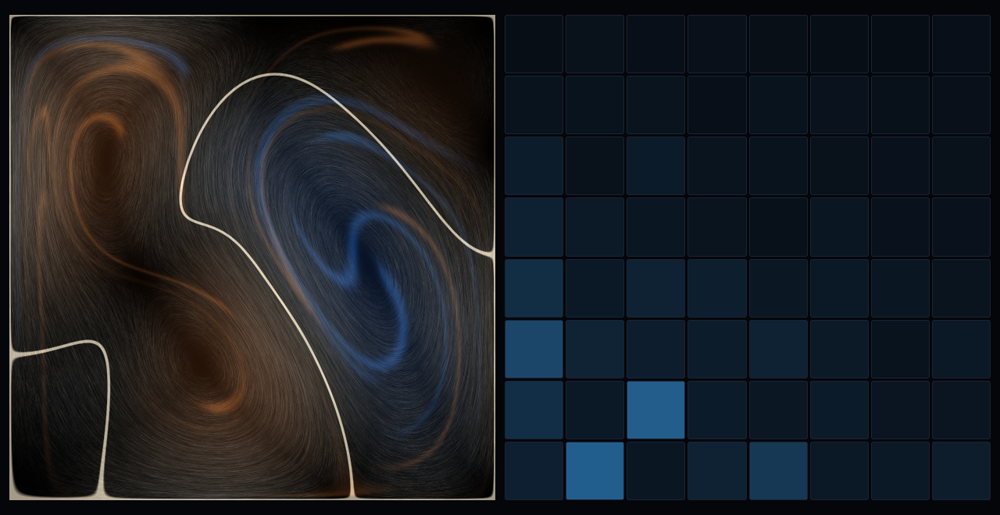

# A Chladni plate made of fluid

A real-time instrument in the browser. A fluid is held on a square plate; every shape it
can take has a sound, and every sound has a shape.



## What it does

The fluid is built from 64 modes, the Laplacian eigenfunctions of the square. Each mode is
a pattern of whirlpools, and each is assigned one pitch.

- **One mode alone is a still figure and a pure note.** It is an exact steady solution of
  the fluid equations, so it holds its shape until it fades.
- **Two or more modes set each other moving.** They exchange energy, the figure starts to
  flow, and frequencies appear that nobody played.
- **Played hard, a chord breaks into a wash.** How much energy goes in decides how far it
  spreads.

The fluid's 64 coefficients are the only state. The picture is drawn from them and the
sound is read from them; nothing is triggered or stored anywhere else.

## Playing it

| Gesture | What happens |
|---|---|
| Press a dark pad | That mode goes into the fluid: you see its figure and hear its note |
| Hold a pad (up to a second) | Plays it harder |
| Press a lit pad | Mutes that mode |
| Drag on the plate | Stirs: a broad push along the drag that moves the large, slow modes |
| Escape | Mutes everything |

Several pads can be pressed at once on a touch screen. Pads glow with how much of their
mode the fluid holds, so the lattice is also a live picture of the spectrum.

On the plate, the bright lines are where the fluid's rotation is zero: the boundaries
between cells turning one way and cells turning the other. Warm and cool tints show the
direction of turning. The fine lines are particle trails and the coloured ribbons are dye
released by each note.

## Running it

```bash
npm install
npm run dev      # then open the printed address
npm test         # solver tests
npm run build    # type check and production build
```

It needs a browser with WebGL 2 and float render targets (current Chrome or Firefox on a
machine with a graphics card).

## How it works

- **Fluid.** The method is De Witt, Lessig and Fiume, *Fluid Simulation Using Laplacian
  Eigenfunctions*. The velocity field is a sum of eigenfunctions, and the fluid equations
  become equations for the coefficients `w`, with the interaction between modes held in a
  precomputed, sparse structure tensor. An even drag on every mode lets notes end.
- **Sound.** One sine per mode at `f = 110 Hz · √(λ/λmin)`, where `λ = k₁² + k₂²`. Its
  loudness follows that mode's coefficient. Because `λ(nk₁, nk₂) = n²·λ(k₁, k₂)`, every
  family of modes lands on an exact harmonic series.
- **Picture.** Each mode's flow is an exact formula, so the graphics card evaluates it per
  pixel from the 64 coefficients. Dye and about 260,000 particles are carried by that flow.
  They are passive, and run six times faster than the fluid so the motion is visible.

## Background

This descends from Aaron Demby Jones's dissertation, *Seeing and Hearing Fluid Subspaces*
(UCSB Media Arts and Technology, 2017), which mapped the modes of pre-rendered 3D fluid
simulations to sound offline. This version runs in real time, so it can be played.

`research/` holds notes from an earlier, more elaborate version of the instrument, kept as
history. `CLAUDE.md` records the working rules and the current state.

## Measuring the sound

With the dev server running, `node tools/measure.mjs <label>` plays a fixed phrase on the
pads in a real browser, records the actual output, and writes a WAV and a JSON report to
`tools/renders/`. `node tools/compare.mjs <a> <b>` prints two reports side by side.
